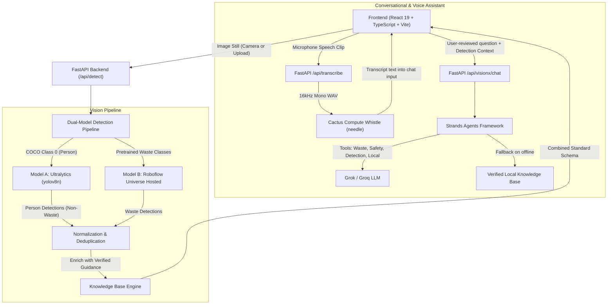

# VisionX — Dual-Model Vision Pipeline & AI Environmental Assistant

VisionX is an enterprise-grade computer vision and conversational AI platform designed to eliminate municipal recycling contamination. It features a real-time **dual-model vision pipeline** (Ultralytics Person Detection + Roboflow Pretrained Waste Detection), an **object-aware Strands conversational agent**, and local on-device **speech-to-text transcription powered by Cactus Compute Whistle**.

---

## 🏗️ System Architecture



---

## 📋 Prerequisites

- **Python:** 3.11 or 3.12 (Python 3.12 recommended)
- **Node.js:** v18+ or v20+
- **Package Managers:**
  - **uv** (ultra-fast Python package and project manager)
  - **npm** (Node package manager)
- **Git**

---

## 🐍 Python Environment Setup with `uv`

VisionX strictly uses **uv** for Python virtual environment management and dependency installations.

### 1. Create the Virtual Environment

```bash
uv venv --python 3.12 .venv
```

### 2. Activate Virtual Environment

- **Windows (PowerShell):**
  ```powershell
  .venv\Scripts\Activate.ps1
  ```
- **Windows (Command Prompt):**
  ```cmd
  .venv\Scripts\activate.bat
  ```
- **Linux / macOS:**
  ```bash
  source .venv/bin/activate
  ```

### 3. Install Backend Dependencies

Maintain one authoritative `requirements.txt`. Install all dependencies from the file:

```bash
uv pip install -r requirements.txt
```

---

## ⚙️ Environment Variables Configuration

Copy `.env.example` to `.env`:

```bash
cp .env.example .env
```

Edit `.env` with your API credentials:

```dotenv
# LLM API key for the post-detection Strands conversational agent
GROK_API=your_grok_or_groq_api_key_here

# Roboflow Pretrained Waste Detection Model Configuration
# Project: https://universe.roboflow.com/ting-ting-s-workspace/yolo-waste-detection-28enj
ROBOFLOW_API_KEY=your_roboflow_api_key_here
ROBOFLOW_WORKSPACE=ting-ting-s-workspace
ROBOFLOW_PROJECT=yolo-waste-detection-28enj
ROBOFLOW_VERSION=1

# Ultralytics Pretrained Person Detection Model (COCO)
ULTRALYTICS_MODEL=yolov8n.pt

# Optional: Force device (cpu or cuda)
VISIONX_DEVICE=cpu
```

> [!IMPORTANT]
> Never commit `.env` or credentials to version control. The `.gitignore` file is pre-configured to prevent secrets from being tracked.

---

## 💻 Frontend Setup

```bash
# Install frontend dependencies
npm ci

# Run development server
npm run dev

# Run frontend linting
npm run lint

# Build production bundle
npm run build
```

The frontend development server runs on `http://localhost:5173`.

---

## 🚀 Backend Execution

Run the FastAPI backend using `uv run` or your activated virtual environment:

```bash
uv run python backend/server.py
```

The server initializes on `http://127.0.0.1:8000`. You can inspect the Swagger documentation at `http://127.0.0.1:8000/docs`.

---

## 🤖 Dual-Model Vision Pipeline

VisionX combines two specialized models on every uploaded photo or camera frame:

### Model A: Ultralytics Person Detection
- Uses official Ultralytics API (`yolov8n.pt` by default, configurable).
- Detects **people only** (COCO class ID `0`).
- Strictly discards non-person classes from this model so bottles, chairs, or cars are never reported as waste by Model A.
- Sets category to `null` / `non_waste`, display label to `Person`, and returns clear non-waste explanation:
  *"Person detected. This is not a waste item, so waste disposal guidance does not apply."*
- Bounding boxes are normalized `[0..1]`.

### Model B: Roboflow Pretrained Waste Detection
- Integrates the project: [ting-ting-s-workspace/yolo-waste-detection-28enj](https://universe.roboflow.com/ting-ting-s-workspace/yolo-waste-detection-28enj).
- Uses hosted REST inference (`https://detect.roboflow.com/{ROBOFLOW_PROJECT}/{ROBOFLOW_VERSION}`) or `inference-sdk`.
- Securely reads `ROBOFLOW_API_KEY` from backend environment variables.
- Detects municipal waste classes (plastic bottles, cardboard, aluminium cans, glass, organics, etc.).

### Overlapping Bounding Boxes & Non-Suppression
- A person holding a plastic bottle will trigger detections from **both** models.
- The pipeline **never** merges or suppresses person detections against waste detections. Both are preserved, assigned unique IDs (`person-1`, `waste-plastic_bottle-1`), and displayed simultaneously.

### Partial Model Failures
The system explicitly tracks per-model status and handles partial failures:
- **`all_succeeded`**: Both models executed successfully.
- **`partial_success`**: One model succeeded (e.g. Person detector succeeded while Roboflow returned an authentication error or timeout). Results from the working model are returned along with the error reason for the failed model.
- **`all_failed`**: Both models failed to execute.
- **`no_objects_detected`**: Both models ran successfully but detected no objects above the threshold.

---

## 🎙️ Speech-to-Text Transcription (Cactus Compute Whistle)

VisionX integrates the **Whistle** automatic speech recognition (ASR) model developed by Cactus Compute via the `cactus-needle` SDK:
- **Model weights:** Lightweight ~16.9 MB model automatically cached upon first use.
- **Supported audio processing:** PyAV decodes arbitrary audio formats (WebM/Opus, Ogg, WAV, MP4) into 16 kHz mono 16-bit PCM WAV.
- **User workflow in Ask AI:**
  1. Click the microphone button in the chat drawer.
  2. Speak your question.
  3. Click Stop. The audio tracks are immediately released.
  4. Whistle transcribes the clip on the backend.
  5. The transcript appears in the chat text input, allowing the user to review or edit before sending.

---

## 💬 Object-Aware Strands Chatbot

The conversational assistant utilizes the **Strands Agents SDK** with compatible model providers:
- **Context Grounding:** The assistant receives the selected detection's label, model source, confidence, bounding box, material, and verification status, alongside all other detections in the same frame.
- **Special Non-Waste Guardrail:** When a `Person` detection is selected, the agent explains that a person was detected, affirms that waste disposal does not apply, and redirects questions to waste items in the image.
- **Deterministic Tools:** `get_detection_context`, `get_waste_guidance`, `search_material_safety`, `get_local_disposal_guidance`.
- **Verified Local Fallback:** If cloud LLM credentials are not configured or external APIs fail, the assistant provides a structured, verified fallback from the local knowledge base, transparently indicating that local knowledge was used.

---

## 🧪 Testing and Verification

Run the comprehensive pytest suite:

```bash
uv run pytest backend/tests -v
```

### Test Coverage Summary:
- **`backend/tests/test_knowledge.py`:** Tests known waste classes, delimiter/case normalization, person non-waste handling, and cautious unknown class resolution.
- **`backend/tests/test_detection.py`:** Tests person-only, waste-only, overlapping person & waste, multiple waste deduplication, no objects, and partial model failures.
- **`backend/tests/test_chat.py`:** Tests selected waste item questions, person detection questions, empty questions, unknown classes, and verified offline fallback.
- **`backend/tests/test_transcription.py`:** Tests valid audio transcription, empty audio, oversized audio rejection (>10MB), and corrupted audio streams.
- **`backend/tests/test_api_endpoints.py`:** Tests all 5 FastAPI REST endpoints (`/api/health`, `/api/knowledge-base`, `/api/detect`, `/api/visionx/chat`, `/api/transcribe`).

---

## ⚠️ Common Setup and Runtime Troubleshooting

1. **Roboflow Authentication Error (HTTP 401/403):**
   - Ensure `ROBOFLOW_API_KEY` is defined in `.env`.
   - If no key is available, the person detection model still operates and the frontend displays a clear status notice.
2. **Microphone Access Blocked:**
   - Browsers require HTTPS or `localhost` to access `navigator.mediaDevices.getUserMedia`.
   - Ensure microphone permissions are granted in the browser settings.
3. **PyTorch / Ultralytics CPU Acceleration:**
   - By default, `VISIONX_DEVICE=cpu` runs inference across standard CPUs without requiring an NVIDIA GPU.

---

## 📄 License

MIT License. Developed for intelligent environmental stewardship and municipal contamination prevention.
